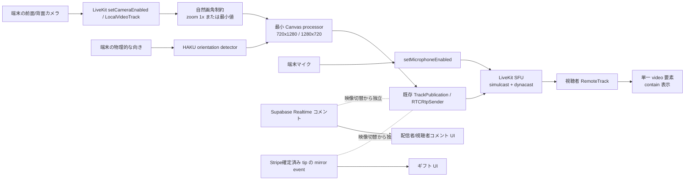

# HAKU LIVE P0 基盤監査

監査日: 2026-10-16
対象: `shunta115/daidougei-haku-app` / `livekit-client@2.21.0`
基準コミット: `bf58cfdad7126d26da6764d552737edb035b30ad`

## 1. 結論

HAKU LIVE の映像経路は、LiveKit の Room、LocalParticipant、TrackPublication、LocalVideoTrack を中核にできている。カメラ切り替えで再 publish は行わず、既存 LocalVideoTrack の `restartTrack` が既存 sender を更新する。マイク、Room、コメント、ギフトはこの処理から分離されている。

現在の独自 Canvas processor は、LiveKit を置き換えるものではない。iPhone Safari が端末縦持ちでもセンサー由来の横長トラックを返す場合に、完全な元フレームを固定の縦横出力へ `contain` 配置することと、切り替え後の実フレーム進行を確認することだけを担当する。実機で raw track が前後カメラ、回転、再開の全マトリクスを安定して満たすまで維持する。

P0 では本番挙動、DB、Stripe、Connect、Supabase データを変更しない。以降はこの文書の責務境界と安全条件に従い、小さな独立 PR で進める。

## 2. 公式資料と公開事例

### LiveKit

- [JavaScript Client SDK](https://docs.livekit.io/reference/client-sdk-js/) — `setCameraEnabled`、`setMicrophoneEnabled`、`switchActiveDevice`、モバイルでの `restartTrack({ facingMode })` を確認した。
- [LocalVideoTrack API](https://docs.livekit.io/reference/client-sdk-js/classes/LocalVideoTrack.html) — `restartTrack`、`replaceTrack`、processor のライフサイクルを確認した。
- [LocalParticipant API](https://docs.livekit.io/reference/client-sdk-js/classes/LocalParticipant.html) — カメラ・マイクの有効化は既存 Publication の mute/unmute を優先する公式経路であることを確認した。

HAKU が固定する方針:

| 責務 | 採用する経路 | 判断 |
| --- | --- | --- |
| Room 接続・再接続 | LiveKit `Room` | 公式 SDK に委譲 |
| カメラ ON/OFF | `LocalParticipant.setCameraEnabled` | 公式 SDK に委譲 |
| マイク ON/OFF | `LocalParticipant.setMicrophoneEnabled` | 公式 SDK に委譲 |
| 前後カメラ切り替え | 既存 `LocalVideoTrack.restartTrack` | Publication、音声、Room を維持 |
| sender の映像差し替え | LiveKit 内部の `RTCRtpSender.replaceTrack` | アプリから直接操作しない |
| 端末の物理的な縦横判定 | HAKU `liveOrientation` | track settings と分離 |
| Safari の向き正規化 | 最小の HAKU processor | 実機マトリクス合格後に撤廃を再評価 |
| 切り替え成功判定 | 実フレーム進行を確認 | 静止画を成功扱いしない |

インストール済み SDK のソースも照合した。`LocalTrack` は processor に新しい入力トラックを接続して `processor.restart` を呼び、processor 出力または新トラックを既存 sender に `replaceTrack` した後で旧トラックを停止する。HAKU processor は WebKit の切り替え後に hidden video の `play()` と複数フレーム進行を明示的に待つ。

### 配信サービスの公開仕様から採用する原則

- [YouTube の縦型ライブ](https://support.google.com/youtube/answer/13822251?hl=ja) — 縦型では映像、チャット、リアクションを一つの全画面体験にまとめる。
- [YouTube のライブ操作](https://support.google.com/youtube/answer/15270973?hl=ja) と [モデレーション](https://support.google.com/youtube/answer/9826490?hl=ja) — 管理権限、保留、ブロック語、低速モード、リプレイを別責務として設計する。
- [YouTube のアーカイブ](https://support.google.com/youtube/answer/6247592?hl=ja) — ライブ終了と録画保存状態を区別する。
- [TikTok LIVE のコメント制御](https://support.tiktok.com/en/live-gifts-wallet/tiktok-live/issues-with-tiktok-live) と [ギフト](https://support.tiktok.com/en/live-gifts-wallet/gifts/) — コメント、リアクション、ギフトを映像を妨げないオーバーレイ操作として扱う。
- [17LIVE のギフト](https://jp.17.live/faq/30515/) と [視聴画面](https://jp.17.live/faq/30096/) — ギフト演出を交流フィードへ統合しつつ、コメント履歴を確認可能にする。
- [Pococha の応援ポイント](https://pococha-jp.pococha.com/hc/ja/articles/31870757702297-%E5%BF%9C%E6%8F%B4%E3%83%9D%E3%82%A4%E3%83%B3%E3%83%88) と [エール・コアファン](https://pococha-jp.pococha.com/hc/ja/articles/31819364423449-%E3%82%A8%E3%83%BC%E3%83%AB-%E3%82%B3%E3%82%A2%E3%83%95%E3%82%A1%E3%83%B3) — 単発の課金額だけでなく継続視聴、コメント、いいねなど複数の参加を可視化する。

公開された仕様・ヘルプだけを設計参考にし、非公開実装の取得や UI の複製は行わない。

## 3. 現在の映像・音声・表示経路

### 開始

1. `/api/livekit/token` がホスト本人、パフォーマー承認状態、公開状態を検証する。
2. `connectAsHost` が Room へ接続する。
3. マイク、カメラを公式 `setMicrophoneEnabled` / `setCameraEnabled` で publish する。
4. 実 track settings と端末の物理的な向きを別々に読む。
5. 自然画角制約を試み、processor の連続フレームを確認してから開始成功とする。

### カメラ切り替え

1. 切り替えボタンを処理中無効化する。
2. 現在の Publication の `LocalVideoTrack.restartTrack` に次の `facingMode` と縦横別解像度を渡す。
3. 選択された device/facingMode、track settings、自然ズームを確認する。
4. processor の source video と Canvas の双方で複数フレーム進行を確認する。
5. 失敗時は元 device を restart し、Room と音声は維持する。

### 視聴

`RemoteTrack` は単一の video 要素へ attach される。音声は autoplay 制約のため専用 audio 要素へ attach する。CSS は表示領域を決めるだけで、映像の向きやクロップを偽装しない。

## 4. 根本原因と再発防止条件

| 症状 | 根本原因 | 現在の防止策 | 維持するテスト |
| --- | --- | --- | --- |
| 縦持ちでも横長 | iPhone Safari が物理回転とは別にセンサー由来の横長 settings/frame を返す | 物理向きと track settings を分離し固定比 Canvas 出力 | 前後 × 縦横 × 回転 |
| 過度な拡大 | `exact 9:16`、crop-and-scale、`object-fit: cover` の重複クロップ | source 全体を `contain`、zoom 1x、背景は単色 | source 全体の表示と zoom 値 |
| 切り替え後に静止 | SDK の processor input 差し替え後、WebKit hidden video の再生・フレーム進行を成功条件にしていなかった | `play()`、source 複数フレーム、Canvas 複数フレームを待つ | 10回切り替えと連続フレーム |
| 背景の二重映像 | 同じ映像を foreground と拡大 blur background に二重描画 | 単色背景 + source 一回描画 | draw 回数と DOM video 数 |
| 回転時 UI 崩れ | viewport 幅だけの breakpoint と縦長コンテナの残存 | short edge + 物理向き、safe area、横画面専用 grid | 縦→横→縦、操作重なり |

再発防止の不変条件:

1. カメラ切り替えで publish/unpublish しない。既存 Publication を更新する。
2. 映像操作は音声 track、Room 接続、コメント、ギフト、視聴者数へ触れない。
3. `getSettings()` の縦横と端末の物理的な縦横を同一視しない。
4. 元映像を引き伸ばさない。完全な元フレームを一度だけ描画し、必要なら小さな単色余白を許容する。
5. `restartTrack` の Promise 完了だけで成功としない。新しい実フレームの継続を確認する。
6. processor instance の出力サイズは不変とし、回転時は安全に新 instance へ交換する。
7. 配信者プレビューと視聴者 video はそれぞれ一要素・一映像レイヤーを基本とする。

## 5. コメント監査

現在の `live_comments` は閲覧と本人投稿を RLS で保護し、Supabase Realtime の INSERT を配信者・視聴者が購読する。一方で次が未完成である。

- `postLiveComment` は `live_session_id` を受け取れるが、現在の両画面は session ID を渡していない。
- 一覧は `performer_id` 単位であり、配信セッション単位に分離されていない。
- Realtime は INSERT のみで、削除が視聴者へ即時反映されない。
- 配信者・モデレーター向け DELETE policy/API がない。
- ユーザー単位ミュート、監査記録、保持期間の責務がない。
- 自動スクロール、手動閲覧中の停止、最新へ戻る操作がない。

P3 は、まず session ID の読書きと UI スクロールを非破壊的に追加する。その後、削除権限、Realtime DELETE、ミュート、監査記録を追加 migration と明示的な RLS で導入する。過去コメントの一括更新・削除はしない。配信終了時削除は既定で無効とし、保持方針と不正対策の合意後に別機能として扱う。

## 6. 責務境界

| 層 | 所有する責務 | 所有しない責務 |
| --- | --- | --- |
| `liveCamera.ts` | capture constraints、device 判定、自然 zoom、switch/recovery | publish、UI、コメント |
| `liveOrientation.ts` / `useLiveLayout.ts` | 物理的な縦横、viewport 分類 | track の再取得 |
| `livePortraitProcessor.ts` | no-crop 合成、出力比、フレーム生存 | Room、Publication、レイアウト CSS |
| `livekit.ts` | Room、公式 track API、attach、品質制御 | UI 状態、Supabase コメント |
| `PerformerLiveScreen.tsx` | 配信状態と操作の編成 | WebRTC sender の直接操作 |
| `LiveWatchScreen.tsx` | 視聴状態と UI | 配信者 camera の操作 |
| `api.ts` | Supabase 読書き・購読境界 | 映像・音声処理 |
| `live.css` | safe area と配置 | 映像 track の向き補正 |

## 7. 段階的実装計画

### P1: カメラ・映像安定化

- 公式 track API を通る単一のメディア制御境界へ整理する。
- 切り替え前後の facingMode、device、width、height、aspectRatio、zoom、readyState、mute/ended、source/Canvas frame advance を診断可能にする。ただし device label や個人情報を永続保存しない。
- Publication ID と audio track が切り替え中に不変であることを自動テストする。
- processor を無効化できる検証フラグは本番 UI に露出せず、実機比較にだけ使う。
- raw track 撤廃判定マトリクスが全て合格するまでは processor を維持する。

### P2: スマホ縦横レイアウト

- 縦は full-viewport、下部に半透明コメント、右側に操作を置く。
- 横は映像中央、コメント overlay、右操作列、終了ボタン、safe area を同時に満たす。
- DOM 上の映像要素を一つに保ち、背景動画レイヤーを禁止する。
- CSS viewport unit、VisualViewport、orientation change を実ブラウザで確認する。

### P3: コメント操作・モデレーション

- 自動スクロール、手動閲覧中の停止、最新へ戻る操作を共有 hook 化する。
- active live session のコメントだけを読み書きする。
- 配信者・明示された moderator だけが削除できる RLS/API を追加する。
- DELETE を購読し、全クライアントへ即時反映する。
- ミュートは非公開の本人情報を表示せず、監査・通報保持方針と分離する。

### P4: 回帰・最適化

- 前後 × 縦横 × ON/OFF × 再接続を自動・実ブラウザ・実機で確認する。
- 長時間時の FPS、CPU、memory、uplink、再接続時間を測定する。
- コメント、ギフト、視聴者数が camera state machine と独立していることを回帰確認する。
- 将来のアーカイブ、視聴者分析、外部 RTMP は別境界に接続し、P0-P3 の状態機械へ混在させない。

## 8. 必須検証マトリクス

| 項目 | 自動 | PC実ブラウザ | Android Chrome実機 | iPhone Safari実機 |
| --- | --- | --- | --- | --- |
| 縦/横の前面・背面 | 制約/合成 | WebRTC映像 | 必須 | 必須 |
| 前→背→前 10回 | mock + frame counter | 必須 | 必須 | 必須 |
| 切り替え後の連続フレーム | source + Canvas counter | 必須 | 必須 | 必須 |
| camera OFF→ON | track/publication | 必須 | 必須 | 必須 |
| mic OFF→ON | track state | 必須 | 必須 | 必須 |
| audio-only→video | track state | 必須 | 必須 | 必須 |
| Room再接続 | event/state | 必須 | 必須 | 必須 |
| 配信者/視聴者映像 | attach test | 2 client | 2 client | 2 client |
| コメントscroll/delete | DOM/RLS | 2 client | 必須 | 必須 |
| ギフト回帰 | mock event | sandboxのみ | UI確認 | UI確認 |

実機で行っていない項目を合格扱いにしない。Stripe 決済実行、本番 DB 書き換え、本番データ削除は検証に含めない。

## 9. 公開とロールバック

各段階を独立ブランチ・独立 PR とし、型チェック、関連テスト、全テスト、production build、PR CI を通す。Stripe/Connect、投げ銭確定、認証、権限、本番 DB を含む差分は camera/UI PR へ混在させない。

公開後は反映 commit と Vercel deployment ID を記録する。障害時は、DB rollback ではなく直前の正常な Vercel deployment の promote/rollback、または対象 PR の revert を使える状態に保つ。カメラ切り替えの成功済み基準は PR #52、単一映像レイヤーと縦横レイアウトの基準は PR #53 とする。

## 10. P0 時点の未解決事項

- iPhone Safari の raw track だけで前後カメラ・回転・再開を安定できるかは実機未確認であり、Canvas 撤廃は未決定。
- Android Chrome と PC の同一マトリクスはこの監査では実機未確認。
- コメントのモデレーター定義、ミュート期間、監査保持期間はプロダクト・権限設計が必要。
- アーカイブ費用、保存期間、出演者同意、外部同時配信キー保管は今回の安定化範囲外。
